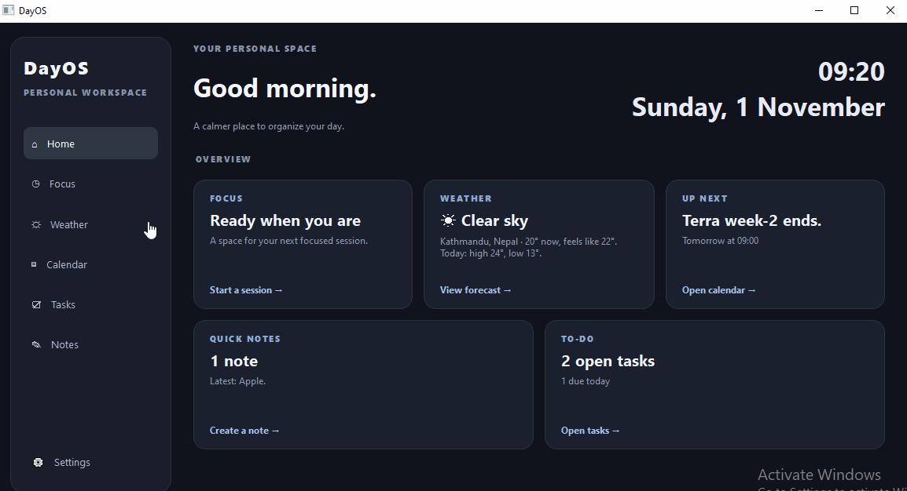

<h1 align="center"> DayOS </h1>

<p align="center"> A desktop productivity tool that's built for focus, convinence and maximum productivity.</p>


<p align="center">
  
  
  
  
</p>

<p align="center">
  
</p>

---
## Platform: Windows

## 📖 About

DayOS is a single place to organize your day. A desktop tool that consist of focus, weather, notes and calender feature all together in one app. This app let's you focus using **Pomodoro Technique**, updates weather data using API, gives you option to take notes in app and everything is stored locally in Json files, the only part that needs the Internet is weather.

## ✨ Features

- **🏠 Home dashboard:** a live overview with your next event, open tasks, latest note, weather and shortcut to start a focus session.
- **⏱ Focus (Pomodoro):** a circular timer with focus(25 min), break(5 min) and long break(20 min) modes.
- **☼ Weather:** shows the real forecast fro where you are
    - Detects your location automactically and provide details, or search fro any city weather detail.
    - Current temperature, feels like, humidity, wind, rain chance and a 7-day forecast.
    - °C / °F toggle and automatic refresh every 30 minutes.
- **▤ Calendar:**  a month view with dots on busy days and a schedule panel for the selected day
- **☑ Tasks**: a to-do list with priorities (low, medium, high), due dates and times.
- **🔔 Reminders**: events and tasks can remind you from "at the time" up to "1 day before", with a pop-up card in the corner and a sound
- **✎ Notes**: a two-panel notes app with search and autosave (Ctrl+N creates a new note)

## 💾 Where is my data?
Everything is stored as plain JSON in a .dayos folder inside your home directory:

your notes
```bash
~/.dayos/notes.json
```
events, tasks and which reminders already rang
```bash
~/.dayos/planner.json
```

## 🌐 Weather data
Weather uses free services that need no account or API key:
- **[Open-Meteo](https://open-meteo.com/)** for the forecast and city search
- **[ipwho.is](https://ipwho.is/)** (with **[ipapi.co](https://ipapi.co/)** as a backup) to estimate your city from your IP address.

## 🚀 How to run:
**Option 1**: Download the Executable (**Recommended**)
1. Go to [Releases](https://github.com/sevenbuilds/Terra_Projects/releases/tag/v1.0.0) page.
2. Download DayOS.exe from the lastest release.
3. Double-click the downloaded file so launch the app.
4. If faced with "**Windows protection**" click **more info**.
5. choose the option "**Run anyway**".
6. Enjoy the app!
---
**Option 2**: Run from source
if you want to run or modify the code:
- you must have **Python 3.13**, **Pygame CE** and **Numpy**.

Install the dependencies:
```bash
pip install PyQt5
```
Clone the repository:
```bash
git clone https://github.com/sevenbuilds/python-learning
```
Navigate to the project directory:
```bash
cd python-learning
```
Run the simulation:
```bash
python main.py
```

## 📄 License

This project is licensed under the MIT License.

## Contact

GitHub: [@sevenbuilds](https://github.com/sevenbuilds)

---

<p align="center">⭐ If you found this useful, consider starring the repo!</p>